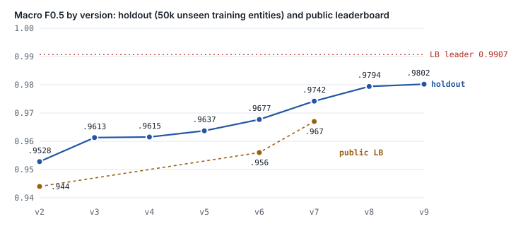
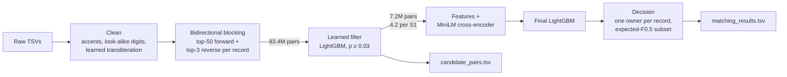

# Business Entity Resolution at 10-million-record scale

**Amazon ML Challenge 2026 · Team Runtime Terrors** (Sridharan Kannan, Arwindh C N, Raghav V S)

Given 1.7M businesses in one source, find every record of the same business among 10M records in two
other sources: with typos, abbreviations, reordered addresses, Indian-script names, and a third country
(France) that never appears in training. We built a five-stage pipeline in three days that went from a
**0.799** rule baseline to **0.9794 macro F0.5** on held-out data, on a single **8 GB MacBook**.



| Version | Main change | Candidates per S1 | Val F0.5 | Holdout F0.5 | Public LB |
|---|---|---:|---:|---:|---:|
| v1 | Hand-tuned rules | 50 | 0.799 | – | – |
| v2 | LightGBM, 38 pair + group features, expected-F0.5 decision | 50 | 0.9520 | 0.9528 | 0.944 |
| v3 | Learned Indian-script → Latin dictionary, shared-address context | 50 | 0.9610 | 0.9613 | – |
| v4 | Learned candidate filter (cascade) | 3.87 | 0.9621 | 0.9615 | – |
| v5 | S1 name-uniqueness context | 3.79 | 0.9644 | 0.9637 | – |
| v6 | Character 3-grams + reverse competition | 3.79 | 0.9688 | 0.9677 | 0.956 |
| v7 | Bidirectional blocking + hub cap | 3.84 | 0.9747 | 0.9742 | 0.967 |
| **v8** | **+ fine-tuned transformer cross-encoder as a feature (final)** | **3.84** | **0.9792** | **0.9794** | – |
| v9 | Deeper reverse blocking (trained, test run not finished) | 3.91 | 0.9798 | 0.9802 | – |

## The problem

- **Sources.** S1 (deduplicated) and S2/S3, each with `business_name`, `business_address`, `country`, and no shared IDs.
  For every S1 business, output all matching S2/S3 records (zero, one or many), plus the candidate set the model scored.
- **Metric.** F0.5 per S1 entity, averaged. Precision counts twice as much as recall; an S1 with no matches
  scores 1 only if nothing is predicted for it.
- **Scale.** Train: 2.2M S1, 10.3M S2+S3. Test: 1.7M S1, 10.0M S2+S3 (US 38%, India 47%, France 15%).
- **Rules.** No external data or APIs; models MIT/Apache 2.0 and at most 8B parameters; outputs must be reproducible from raw data.

What the data looked like (measured, not assumed): only 5.6% of S1 have no match, the average is 3.46 matches;
no S2/S3 record ever belongs to two S1 businesses; singletons come with planted look-alikes (same name and
street, different house number); 23.5% of India S2 names are in Indian scripts, S1 names never are; French
businesses share an address twice as often as US or Indian ones.

## How it works



1. **Rarity-based blocking over a packed index.** Keys come from each record's *rarest* words: name words,
   name-word pairs, a name prefix, house number × address word, address-word pairs. Every key is a 40-bit hash
   packed with a 24-bit record number into one sorted `uint64` array per country, so a lookup is a binary
   search. Candidates are ranked by Σ log(N / block size). Val recall at 50 candidates per S1: 0.953.
2. **Bidirectional blocking.** Every S2/S3 record is also searched *backwards* against the full S1 file, and
   its best 3 S1 businesses are added as candidates, at most 20 per S1. The cap stopped a "hub" business that
   collected 142,645 candidates through the word "com". Recall: 0.953 → 0.971.
3. **A learned candidate filter (cascade).** A first LightGBM scores the ~54 candidates per S1 and keeps
   those with p ≥ 0.03: 13× fewer candidates (86M → 7.2M on test) at no loss in F0.5. Its training
   probabilities are out-of-fold, so the final model trains on realistic candidate sets.
4. **Features that see the context.** Name/address similarities (RapidFuzz), house-number agreement, character
   3-gram cosine, *group* features (how this candidate compares with the other candidates of the same S1) and
   *whole-file* counts (how many S1 businesses share this address, street or core name). Country is never a feature.
5. **A fine-tuned transformer as one feature.** `cross-encoder/ms-marco-MiniLM-L-6-v2` (Apache 2.0, 22.7M
   parameters) reads `"name | address" [SEP] "name | address"`. It is fine-tuned in two folds split by S1
   entity, so each model only scores entities it never trained on; test gets the average. Alone it scores
   0.961; as a LightGBM feature it adds +0.005 (0.9742 → 0.9794).
6. **Learned transliteration.** A 1,305-word Indian-script → Latin dictionary learned from training pairs
   only ("ड्रीम बिजनेस" → "dream business"). True-pair name similarity went from a median of 0.10 to 1.00.
7. **Decision layer.** Each S2/S3 record goes to at most one S1 (its best), then each S1 keeps the subset of
   candidates that maximises expected F0.5, including predicting nothing. Tuned on val, checked once on holdout.

Full write-up: [docs/METHODOLOGY.md](docs/METHODOLOGY.md) · every experiment: [docs/EXPERIMENT_LOG.md](docs/EXPERIMENT_LOG.md) ·
the three-day story: [docs/Runtime_Terrors_Journey.pdf](docs/Runtime_Terrors_Journey.pdf)

## Engineering on 8 GB of RAM

| Where memory ran out | What we changed | Result |
|---|---|---|
| Loading the three train TSVs (~6 GB) | Parquet copies verified identical; one big file at a time; only the needed columns and rows | 0.4 s per file instead of ~6 s |
| Blocking v1 with Python string keys (8.6 GB peak) | Integer word IDs; 40-bit key hash + 24-bit record ID in one sorted `uint64` array; per-country pools; 5k-query batches; keys shared by > 300 records dropped | **3.7 GB** peak |
| Official validator on 86M candidate IDs (~10 GB) | Streamed our own checker line by line; later the cascade shrank the file to 7.2M IDs | Full validator fits again |
| 15–21M labelled training pairs | Each batch streamed to Parquet; only needed columns as float32; 80% of training entities from v7 on | v9's 20.7M pairs trained on the laptop |
| Reverse search (60M links for US train) | 32-bit accumulation, 20k-record chunks, arrays freed early, hub cap | Bidirectional blocking fits |
| Transformer on the Apple GPU (shares the 8 GB) | Stages run strictly one after another; no side jobs during long runs | v8 test run finished in 6.4 h (swap-bound during India) |

## What did not work

- An ensemble of three LightGBMs: 0.9660 vs 0.9661 for a single model.
- A whole-core-name blocking key, and a cheap similarity re-rank of candidates: no gain or worse.
- Half precision on the Apple GPU: slower (435 vs 548 pairs/s).
- Deeper reverse blocking (v9): +0.0046 recall but only +0.0008 F0.5. The extra true pairs are the hard ones.

Where the remaining error is (v7, val): 41.5% true matches never reach the candidate set, 31.8% rejected by
the model, 12.1% wrong merges. A perfect matcher on v7's candidates would score 0.9895.

## Repository layout

```
code/business_entity_resolution/
  src/                 all pipeline code (blocking, features, cascade, cross-encoder, decision, prediction)
  src/model/README.md  how to get the pretrained model; trained models are rebuilt, not stored
  README.md            exact run steps, data → blocking → matching → output
  requirements.txt     pinned versions (Python 3.14, pandas 3, LightGBM 4.7, torch 2.14, transformers 5.17)
  run_*.sh             the unattended pipelines we ran (with recall and holdout gates)
docs/                  methodology, experiment log, journey PDF, score chart
explore.py             first look at the data
```

## Reproducing

The challenge data is **not** included and must not be redistributed. With the challenge kit's `dataset/`
folder next to this README:

```bash
python3.14 -m venv .venv && .venv/bin/pip install -r code/business_entity_resolution/requirements.txt
```

Then follow [code/business_entity_resolution/README.md](code/business_entity_resolution/README.md): convert to
Parquet, split, learn the transliteration, build pairs, train the cascade, fine-tune the cross-encoder, train
the final model, predict. On an M2 MacBook with 8 GB the full sequence takes about 11 hours, most of it the
transformer. A CUDA GPU makes the transformer steps several times faster.

## Team

- **Sridharan Kannan** (team lead): exploration notebooks; the reverse-competition idea behind v6 and v7.
- **Arwindh C N**: pipeline, experiments, submissions.
- **Raghav V S**: modelling review (class imbalance, tree size, blocking design).

## License

Code: [MIT](LICENSE). The pretrained MiniLM cross-encoder is Apache 2.0 (downloaded separately). The challenge
data belongs to the organisers and is not part of this repository.
